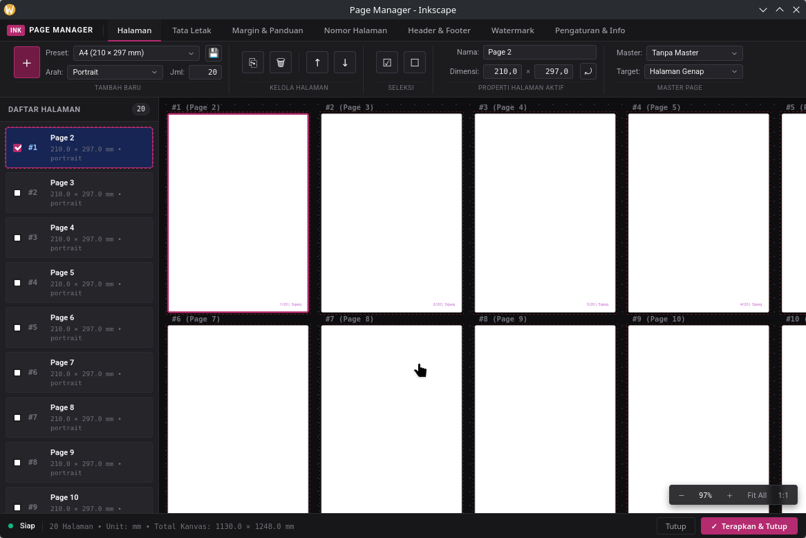

<p align="center">
  
</p>

# Page Manager for Inkscape

Inkscape page management extension to enhance native Page tool functionality. Designed to help users manage and arrange multiple pages quickly and practically, including page numbering, watermarks, and margin layout arrangements.

Built with a **Python Backend + Web-based GUI (WebKit2GTK / Native Window / App-mode Browser)** architecture and an **intuitive, visual, and modern Ribbon UI** inspired by professional desktop productivity software.

<p align="center">
  
</p>

---

## Key Features

0. **Page List & Visual Page Sorter:**
   - Displays all pages in the Inkscape document with proportional thumbnails, sequence numbers, dimensions ($W \times H$), document units (`mm`, `px`, etc.), and orientation.
   - Interactive canvas with zoom and pan to inspect the full document layout in real time.

1. **Page CRUD & Size Presets:**
   - Add new pages with standard dimension presets:
     - **ISO Series:** A3, A4, A5, A6, B4, B5
     - **US Standards:** US Letter, US Legal, Tabloid
     - **Digital / Social:** Instagram Post (1080x1080), Story / Reels (1080x1920), Full HD (1920x1080)
     - **Custom:** Custom dimensions in document units.
   - Toggle between Portrait and Landscape orientation with a quick-switch button.
   - Multi-page selection, duplication, and batch deletion.

2. **Auto-Layout, Reorder & Master Pages:**
   - Automatically rearrange page coordinates across the canvas:
     - **Grid Matrix:** Arrange into $N$ columns with uniform spacing (gap).
     - **Horizontal Row:** Align pages side by side from left to right.
     - **Vertical Column:** Stack pages downwards from top to bottom.
     - **Book / Spreads:** Facing pages layout (Page 1 right cover, followed by 2-page spreads 2-3, 4-5, etc.).
   - **Artwork Auto-Shift:** Automatically moves artwork elements along with their respective pages during layout repositioning or reordering.
   - **Master Page Templates:** Clone objects from a designated master page to All, Even, Odd, or Selected pages using live SVG `<use>` elements.
   - Move page order up or down (*Move Up / Move Down*).

3. **Margins, Bleed & Canvas Guides:**
   - Configure page margins (Top, Bottom, Left, Right) and Bleed values.
   - Automatically generate native Inkscape canvas guides along margin boundaries.

4. **Smart Page Numbering:**
   - Generates page numbers on a dedicated non-destructive layer (`layer_page_numbers`).
   - Format styles: Arabic (`1, 2, 3`), Roman (`I, II, III` / `i, ii, iii`), Alphabet (`A, B, C`), or Custom (`Page {n} of {total}`).
   - Flexible placement (Top/Bottom, Left/Center/Right) with configurable margin offsets.
   - Option to skip the cover page.

5. **Header & Footer:**
   - Left, Center, and Right text slots for Headers and Footers.
   - Dynamic variable replacement: `{page}` (page number), `{total}` (total pages), `{date}` (current date).
   - Image logo support with position options (Top/Bottom, Left/Center/Right).
   - Configurable divider lines and skip-cover option.
   - Managed on a dedicated non-destructive layer (`layer_header_footer`).

6. **Watermarks:**
   - Custom text watermarks (e.g., "DRAFT", "CONFIDENTIAL") and graphic image stamps.
   - Angle rotation ($-45^\circ$, $0^\circ$, $45^\circ$, $-90^\circ$).
   - Opacity, font size, and color adjustments.
   - Managed on a dedicated non-destructive layer (`layer_watermark`).

---

## System Requirements

- **Inkscape 1.2+** (Inkscape 1.3 or 1.4+ recommended)
- **Linux:**
  - `python3-gi`, `gir1.2-gtk-3.0`, `gir1.2-webkit2-4.1` (or `gir1.2-webkit2-4.0`)
  ```bash
  sudo apt install python3-gi gir1.2-gtk-3.0 gir1.2-webkit2-4.1
  ```
- **Windows / macOS:**
  - Runs automatically via Chrome or Edge in App Mode (`--app=...`) or via `pywebview`.

---

## Repository
[https://github.com/raniaamina/Inkscape-Page-Manager](https://github.com/raniaamina/Inkscape-Page-Manager)

## Disclaimer 
We don't guarantee anything about this tool/extension, so please use it at your own risk. We can't provide 24/7 support if you encounter issues when using this project.

If you find this tool helpful, feel free to support development: [Support Dev on Saweria](https://saweria.co/raniaamina) :")

## License
This project is licensed under the GNU General Public License v3.0 (GPLv3). See the [LICENSE](LICENSE) file for details.
